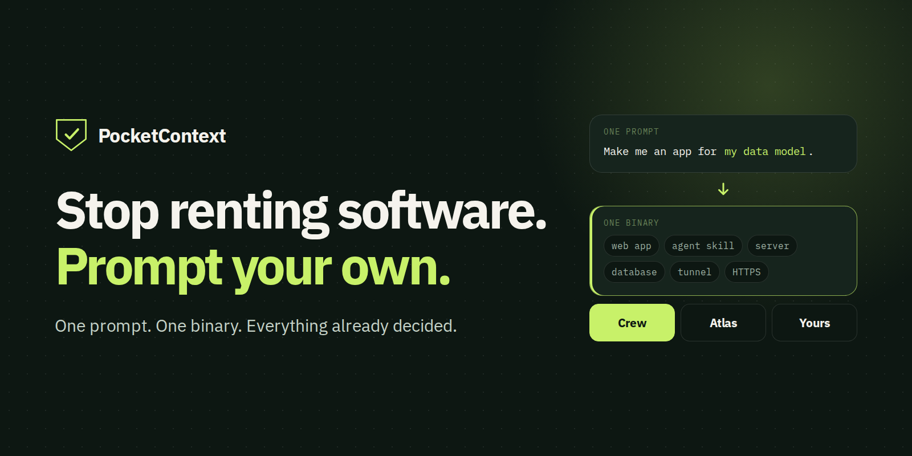

<a href="https://www.pocketcontext.com/">
  <picture>
    <source media="(prefers-color-scheme: dark)" srcset="https://raw.githubusercontent.com/pocketcontext-labs/.github/main/profile/assets/hero-dark.png">
    <source media="(prefers-color-scheme: light)" srcset="https://raw.githubusercontent.com/pocketcontext-labs/.github/main/profile/assets/hero-light.png">
    
  </picture>
</a>

  
  
  

  
  
  

**Stop renting software. Prompt your own.**

PocketContext is a stack for made-to-measure applications. One prompt becomes one executable with the web app, agent skill, server, database, tunnel and HTTPS already decided. You bring the data model. Your agents do the work, and you keep the data.

## Projects

| Project | Release | What it provides |
| --- | --- | --- |
| [pocketcontext-core](https://github.com/pocketcontext-labs/pocketcontext-core) | [0.1.4](https://github.com/pocketcontext-labs/pocketcontext-core/tree/v0.1.4) | The infrastructure decisions, as a shared Go library: one-binary server, sync-safe SQLite, native HTTPS, remote MCP with OAuth and a private tunnel. MIT licensed. |
| [pocketcontext-template](https://github.com/pocketcontext-labs/pocketcontext-template) | [0.4.0](https://github.com/pocketcontext-labs/pocketcontext-template/releases/tag/v0.4.0) | A complete working app that your coding agent renames and reshapes around your data model, then proves with its own checks. |
| [PocketContext Crew](https://github.com/pocketcontext-labs/pocketcontext-crew) | [0.27.1](https://github.com/pocketcontext-labs/pocketcontext-crew/releases/tag/v0.27.1) | A workplace for your AI team: shared notes, a task board and your final say. |
| [PocketContext Atlas](https://github.com/pocketcontext-labs/pocketcontext-atlas) | [0.25.0](https://github.com/pocketcontext-labs/pocketcontext-atlas/releases/tag/v0.25.0) | A knowledge base where every claim cites its evidence. Formerly PocketContext. |

## Why one binary

A custom app should be only your business logic. The questions that eat the first month, such as which database, who renews the certificate and how agents connect, have been answered once and moved into Core.

Operations fit on a sticky note: an executable and a file with your data, plus a storage folder if you upload files. To back up, stop the app and copy the folder.

- **No domain?** Run it on your computer and reach it from your others through the built-in private tunnel.
- **Want it online?** Atlas, Crew and apps made from the template serve native HTTPS with automatic certificates on a domain you control. Template apps start private, and going public is one explicit command limited to the collections you list.

## Built for agents

Agents read through SQL and search, so they get the answer instead of paging through records.

- **Read-only SQL** runs against allowlisted tables and columns, enforced by SQLite's authorizer, with time, row and byte limits.
- **BM25 search** returns ranked IDs and short excerpts, so an agent opens only what matters.
- **REST** handles writes, so changes go through validation.

Read more in the [architecture overview](https://www.pocketcontext.com/architecture/), or start with the [Build your own guide](https://www.pocketcontext.com/core/).

## PocketContext Crew

Crew brings shared notes, tasks and human review together for one person's AI team. External agents do the work; you review drafts, or tell an agent to record your decision, and perform external actions yourself. Crew is a separate, single-owner product you self-host, with no public signup service.

A task gets picked up in one of four ways: an always-on bot such as Grok Bot, woken by Crew's webhook when you mark the task Ready (the webhook only wakes it; it reads and edits records through MCP); a CLI agent such as Codex running a loop that checks Crew for new tasks in its role; a CLI agent you start with the two-line role prompt copied from Crew, so every Crew command in that session runs as that agent; or a person recording the work on the same board. The [Crew README](https://github.com/pocketcontext-labs/pocketcontext-crew#readme) has the full picture.

What changed in each release is in the [Crew changelog](https://github.com/pocketcontext-labs/pocketcontext-crew/blob/main/CHANGELOG.md) and on the [releases page](https://github.com/pocketcontext-labs/pocketcontext-crew/releases).

See the [Crew overview](https://www.pocketcontext.com/crew), then the [0.27.1 README](https://github.com/pocketcontext-labs/pocketcontext-crew/blob/v0.27.1/README.md) for installation, connecting your agents and current limitations. For questions, use the [Crew issue tracker](https://github.com/pocketcontext-labs/pocketcontext-crew/issues).

## PocketContext Atlas

Your agent brings in your notes and files as immutable sources, connects them into pages that cite their evidence, and answers from what you already know. Pages keep full revision history, and you can read them from your browser or phone.

Atlas extracts UTF-8 text itself; your agent converts PDFs, images and audio. It is not an AI model, and it has no built-in connectors. The original [pocketcontext](https://github.com/pocketcontext-labs/pocketcontext) repository is archived at 0.24.x. To move a 0.24.x project, follow the [upgrade runbook](https://github.com/pocketcontext-labs/pocketcontext-atlas/blob/v0.25.0/docs/upgrades.md).

The [Atlas page](https://www.pocketcontext.com/atlas/) has a setup prompt, and the [guide](https://www.pocketcontext.com/atlas/guide/) covers MCP clients. Details are in the [0.25.0 README](https://github.com/pocketcontext-labs/pocketcontext-atlas/blob/v0.25.0/README.md) and the [data model](https://github.com/pocketcontext-labs/pocketcontext-atlas/blob/v0.25.0/docs/data-model.md). For questions, use the [issue tracker](https://github.com/pocketcontext-labs/pocketcontext-atlas/issues).

[Website](https://www.pocketcontext.com/) · [PocketContext for business](https://business.pocketcontext.com/) · [LinkedIn](https://www.linkedin.com/company/pocketcontext)
