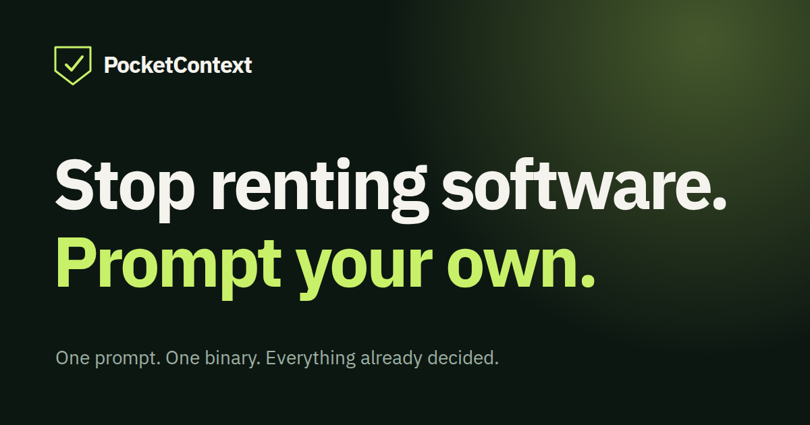

Give your agent a second brain. PocketContext is a local knowledge base in one program — a server, a browser reader and a command-line client for macOS, Linux and Windows. Your agent brings in your notes as sources, connects them into pages that cite their evidence, and answers from what you already know. You choose the machine: your own computer, or alongside an always-on agent.

## Projects

| Project | What it provides |
| --- | --- |
| [PocketContext](https://github.com/pocketcontext-labs/pocketcontext) | The knowledge base: immutable sources (text notes, and PDFs, images or audio your agent converts to text), Markdown pages with structured properties and citations, full revision history, authenticated search and SQL reads, and an installable skill for Claude Code, Codex and Antigravity. |
| [PocketContext Crew](https://github.com/pocketcontext-labs/pocketcontext-crew) | A self-hosted workspace for one person's AI team: versioned Markdown memory, a shared task board and human review through one authenticated MCP connection. |

## PocketContext

- **Answers with sources.** Pages keep their citations and revision history, so you can see how a page developed and what supports it.
- **Works with the tools you already use.** Your agent brings text from Notion, Obsidian, Gmail, Jira and others through its own authorized tools. PocketContext has no built-in connectors.
- **Explore your knowledge.** Browse published pages and searchable original sources, follow citations to highlighted passages, and organize topics and catalogs through page properties.
- **Organize with spaces.** A project belongs to one person, and spaces simply partition that knowledge. New projects start with one space, Default; you or your agent can create, rename, archive and restore spaces and choose the default. Archiving preserves evidence and history.
- **Choose a knowledge base by name.** A private registry and router skill select each knowledge base’s own binary and commands. Local commands run headless over a private socket; the reader opens loopback TCP when needed.
- **Use it from another computer.** A built-in private tunnel connects your computer to the server on an agent computer, exposing only the project's service. The server's agent generates one client setup prompt to paste into the other computer's agent; the saved connection can be reused after restarts.
- **Read on your phone.** Optional native HTTPS serves the reader on a domain you control, with automatic certificates and a sign-in link. PocketContext has no built-in chat: the reader is for browsing and search.
- **Connect your agent through MCP.** An opt-in remote MCP endpoint on that domain lets compatible chat apps, coding agents and desktop clients use your knowledge after you approve access in the browser. Server administration stays local.
- **Stays yours.** One person, one server with authenticated clients, and a project folder you can back up: a SQLite database, a storage folder and a configuration file, with the program that opens them beside them.

Version 0.24.0 stores any file but extracts only UTF-8 text itself: your agent converts PDFs, images and audio, and PocketContext marks that text as derived evidence. PocketContext is not an AI model: your agent supplies the reasoning, scheduling and access to other services. Since 0.12.0 an optional helper in the repository imports an existing Obsidian collection as pages, keeping the original files as sources. The program lives in the project folder, and its installers ask you to name that folder. Projects from 0.11.x onward open without data conversion. Like every release since 0.11.0, it does not open databases created by 0.10.0 or earlier and has no upgrade path: export what you need with the earlier release and start a new project.

### Get started

The [PocketContext website](https://www.pocketcontext.com/) has a setup prompt that asks whether to create a knowledge base here or connect to one elsewhere, and a guide that includes MCP client setup. Or ask an agent that can run commands to follow the [0.24.0 README](https://github.com/pocketcontext-labs/pocketcontext/blob/v0.24.0/README.md): it installs the binary into the project folder you name, creates a project and installs the skill. Downloads and release notes are on the [0.24.0 release page](https://github.com/pocketcontext-labs/pocketcontext/releases/tag/v0.24.0); the [data model](https://github.com/pocketcontext-labs/pocketcontext/blob/v0.24.0/docs/data-model.md) covers the details. For questions and contributions, use the [issue tracker](https://github.com/pocketcontext-labs/pocketcontext/issues).

## PocketContext Crew

Crew brings shared memory, tasks and human review together for one person's AI team. Memory buckets hold Markdown notes with revision history and restoration. An AI Team board tracks assignments, comments and drafts, while a review inbox lets the owner decide on exact draft versions. Archive and restore preserve history.

Your agents run in external tools and connect through one authenticated MCP endpoint, where they can search notes and tasks or run bounded read-only SQL reports. An optional webhook notifies a dispatcher bot when assigned work is ready; version 0.7.0 adds opt-in wakes from your own task comments and an owner-set handoff limit that stops bot-to-bot loops. You review drafts and perform external actions yourself; approval does not publish anything or complete a task. Bucket responsibility is a working convention, with shared access for connected agents.

### Get started

Crew is a separate, single-owner product you self-host with a new project database. There is no public signup service. See the [Crew overview](https://www.pocketcontext.com/crew), then follow the [0.7.0 native Linux installation guide](https://github.com/pocketcontext-labs/pocketcontext-crew/blob/v0.7.0/docs/native-install.md) or the [Docker Compose alternative](https://github.com/pocketcontext-labs/pocketcontext-crew/blob/v0.7.0/docs/install.md). The [0.7.0 README](https://github.com/pocketcontext-labs/pocketcontext-crew/blob/v0.7.0/README.md) covers connecting your agents and current limitations. For questions and contributions, use the [Crew issue tracker](https://github.com/pocketcontext-labs/pocketcontext-crew/issues).

[Website](https://www.pocketcontext.com/) · [PocketContext for business](https://business.pocketcontext.com/) · [LinkedIn](https://www.linkedin.com/company/pocketcontext)
